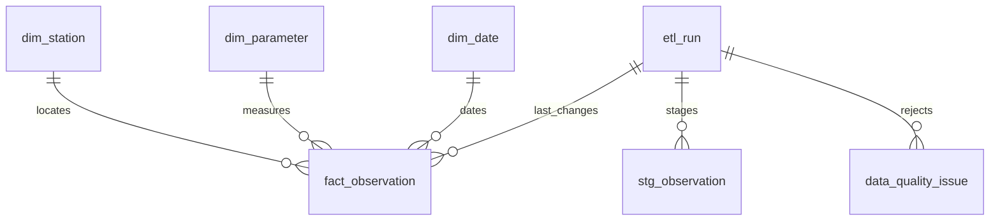

# Data model, source contract and definitions

## Real public-data edition

The public explorer uses **genuine City of Adelaide Torrens Lake data**: 120 files under `torrens/` spanning June 2015–September 2018, three stations, fields `WTemp`, `E_Cond`, `O2_mg`. Attribution: City of Adelaide, [Torrens Lake Meterological Data](https://data.sa.gov.au/data/dataset/torrens-lake-meterological-data), [CC BY 4.0](https://creativecommons.org/licenses/by/4.0/). Source/member hashes: `data/real/manifest.json`.

The isolated real DB is `runtime/real-v2/warehouse.sqlite`. Stations: `A5041054`, `A5041055`, `A5041056`; parameters: `TEMP`, `EC`, `DO`. Conductivity is in situ, not corrected `Sp_Cond`; oxygen is mg/L. pH is not selected because it is not shared across all three station schemas.

Source timestamps have no timezone. Opt-in `timestamp_basis='source_unspecified'` requires naive timestamps and preserves their reported dates and clocks. Default synthetic mode requires an offset and normalises to UTC. Never mix those modes in one DB. Audit times are UTC. Real fact grain is station + parameter + source-clock timestamp, not asserted UTC.

There are 1,012,773 selected source values, 1,012,742 accepted facts and 31 missing temperature values. No interpolation or zero-fill. Published zeros are retained. Selecting only `torrens/` avoids duplicate root-level copies. Table relationships remain as below.

The public report contains 10,566 daily means with valid sample counts and raw extrema. Monthly means weight by sample counts. Days with readings counts distinct source dates with at least one measurement at any selected location. Station cards count each station's distinct dates separately. Neither measure is sensor uptime or 15-minute completeness. Partial years and missing archive dates are disclosed without inferring a cause. Combined-station means give locations with more readings more weight. All-years views cover 40 calendar months; single-year views show all 12 months, with absent months left blank.

The following source, daily cadence and UTC descriptions apply to the separate **synthetic test fixture edition only**.

## Source

`warehouse/generate.py` creates daily observations for four fictional stations and three parameters during 2025, using seed 863567. Every 23rd station-day is omitted according to a deterministic rule. Each remaining station-day has one observation per parameter. The fixture appends five duplicate rows and eight invalid rows. No external datasets, geographic coordinates, government data, personal information or actual environmental observations are included.

Expected CSV columns, in order:

| Column | Contract |
| --- | --- |
| `station_id` | Registered code in `dim_station` |
| `parameter_code` | Registered code in `dim_parameter` |
| `observed_at` | ISO timestamp with explicit timezone, whole-second precision |
| `value` | Finite numeric measurement |
| `unit` | Exact canonical unit for the parameter |

Temperature uses `degC`, pH uses `pH`, conductivity uses `uS/cm`. No implicit unit conversion occurs. Timestamps normalise to UTC before duplicate detection. Date keys are UTC dates; seasons are Southern Hemisphere seasons. This does not implement South Australian local-time calendar boundaries.

The file contract rejects missing, additional, reordered or renamed columns. Malformed rows are quarantined. Unknown stations/parameters, unexpected units, invalid or naive timestamps, non-finite/non-numeric values, pH outside 0–14 and negative conductivity are rejected. The physical plausibility rules are not environmental safety thresholds. Source-specific QC flags, detection limits, station activation dates, laboratory methods and sample identifiers would need explicit modelling for real data.

## Grain and relationships

**Fact grain: one observation per station, parameter and UTC timestamp.** The composite primary key enforces this. Real samples with multiple methods or replicates would require a richer key.



| Table | Key | Main attributes and meaning |
| --- | --- | --- |
| `dim_station` | `station_id` | Fictional name and region; fixed reference metadata |
| `dim_parameter` | `parameter_code` | Parameter name and canonical unit |
| `dim_date` | `date_key` | ISO date, year, month, quarter and Southern Hemisphere season |
| `fact_observation` | station + parameter + timestamp | Value, date key and last value-changing run |
| `etl_run` | UUID `run_id` | UTC start/end, status, source basename/hash, committed counts and error |
| `stg_observation` | run + CSV row number | Original parsed row JSON from successful loads |
| `data_quality_issue` | run + CSV row number | Rejected row JSON and one reason per rejected row |

`vw_monthly_monitoring` groups observations by location, parameter, year and month. It exposes count, arithmetic mean, minimum and maximum. `vw_pipeline_health` exposes operational run status and counts. Foreign keys prevent orphan observations; station and parameter identifiers are natural keys. Date dimensional attributes avoid repeatedly deriving calendar fields in SQL. Dimensions are not versioned in this prototype.

## Processing semantics

1. Read the file once; hash, archive and parse those exact bytes.
2. Commit a `running` audit entry before attempting the data transaction.
3. Lock the writer path, verify the header and stage rows inside the transaction.
4. Quarantine invalid rows. For valid repeated keys within a file, the first valid row wins and subsequent rows are rejected.
5. Insert new keys, update changed values and skip unchanged values. `last_run_id` changes only when the value changes.
6. Commit facts, dimensions, staging, quality issues and successful counts together.
7. On failure, roll back data changes and separately commit a failed audit status. Raw archived bytes remain available for diagnosis.

Successful count identities:

```text
received = accepted + rejected
accepted = inserted + updated + unchanged
```

A failed run reports zero committed counts, even if processing had begun. It does not report the number of attempted rows. A hard process termination may leave a `running` entry: investigate rather than automatically marking it successful.

This is incremental **warehouse mutation**, not a source watermark implementation: each submitted file is scanned fully. Rerunning an unchanged file is idempotent for facts and still produces a new audit record and rejection events. Later submitted files are authoritative for corrections; there is no source revision check. Never replay an older snapshot over approved corrections without review. Historical raw/staged rows permit inspection, but the fact table does not implement full temporal history.

## Dashboard definitions

- Observation count: selected fact rows.
- Coverage: distinct selected `(station_id, UTC date)` pairs divided by selected stations × days in selected full calendar year, for one parameter.
- Missing station-days: expected station-days minus observed station-days.
- Monthly mean: arithmetic mean of selected individual observations; stations with more readings receive greater weight.
- Latest observation: maximum selected observation date, independent of ETL run time.
- Rejection totals: events across successful runs; reruns repeat these events.
- Pipeline tables show all runs and do not respond to observation filters.

All four demo stations are assumed active for the entire year, daily. Real coverage needs an expected schedule and activation history. The HTML is an exported snapshot; rerun the report command after loads.
